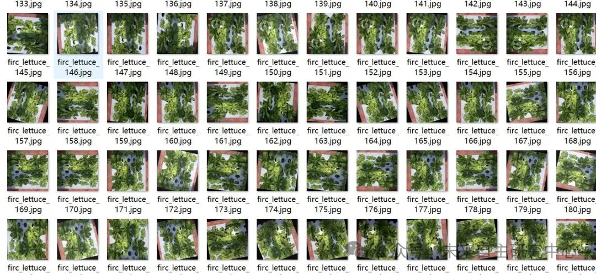
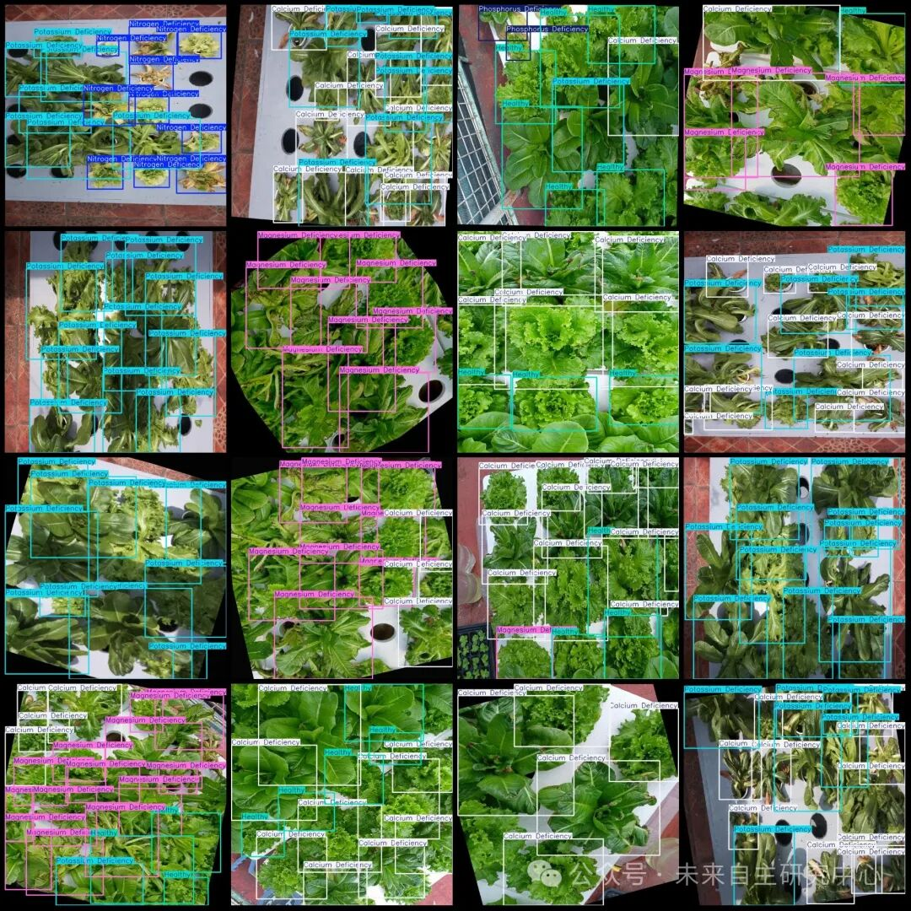

# Lactaid Deficiency Symptoms Ca, Mg, N, P, K Detection Dataset in VOC+YOLO format with 2978 images across 6 categories

Dataset format: Pascal VOC format + YOLO format (txt file without split path, only containing jpg images and corresponding VOC format xml files and yolo format txt files)

Number of images (number of jpg files): 2978

Number of annotations (number of xml files): 2978

Number of annotations (number of txt files): 2978

Label count: 6

Label category names (note that the order in YOLO format does not correspond to this, but is based on the classes.txt file in the labels folder): ["Calcium Deficiency", "Healthy", "Magnesium Deficiency", "Nitrogen Deficiency", "Phosphorus Deficiency", "Potassium Deficiency"]

Number of boxes labeled in each category:

Calcium Deficiency Frames = 8133

Healthy Frames = 8083

Magnesium Deficiency Frames = 5784

Nitrogen Deficiency Frames = 7745

Phosphorus Deficiency Frames = 7830

Potassium Deficiency

Total frames: 44552

Using labelImg:

Annotation rules: Draw a rectangle around the category.

Important Notice: No

Special : This dataset does not guarantee the accuracy or precision of the trained models or weight files. The dataset is provided with accurate and reasonable annotations only.

Image Preview:

Annotation example:

## Payment

Here is a pay link on Stripe ( https://buy.stripe.com/3cs8yP7sY87d0vu9AB ). Please contact me lonlonago@foxmail.com after funding $89, and I will send you a complete data files , thank you!

